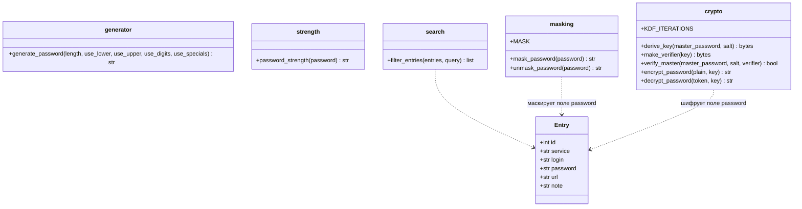

# Архитектура «Менеджер паролей» (день 3)

## Слои
| Слой | Модуль | Ответственность |
|---|---|---|
| UI | src/ui (дни 5-6) | окна, таблица записей, кнопки |
| Ядро | src/core | генерация, оценка надёжности, маскирование, поиск, шифрование |
| Данные | src/data (день 4) | SQLite, CRUD записей |

Зависимости идут только вниз: UI -> ядро -> данные. Ядро не импортирует tkinter и sqlite3, поэтому тестируется отдельно (требование ТЗ раздел 5).

## Диаграмма классов

Модули ядра реализованы как наборы функций, а не классов: состояния у них нет. Единственная сущность с данными - Entry (dataclass).

## Контракт интерфейсов
Названия и сигнатуры обязательны для разработчика, UI и слоя данных.

| Модуль | Элемент | Поведение |
|---|---|---|
| models | `Entry(id=None, service="", login="", password="", url="", note="")` | dataclass |
| generator | `generate_password(length=16, use_lower=True, use_upper=True, use_digits=True, use_specials=False) -> str` | длина 8-64, иначе ValueError; все наборы выключены -> ValueError("Выберите хотя бы один набор символов"); минимум один символ из каждого выбранного набора; генератор secrets |
| strength | `password_strength(password) -> str` | "weak", "medium" или "strong" |
| masking | `MASK`, `mask_password(password) -> str`, `unmask_password(password) -> str` | маска фиксированной длины 8 точек, для пустой строки - пустая строка |
| search | `filter_entries(entries, query) -> list[Entry]` | подстрока в service или login без учёта регистра; пустой запрос - весь список |
| crypto | `KDF_ITERATIONS = 480_000` | число итераций PBKDF2-HMAC-SHA256 |
| crypto | `derive_key(master_password, salt) -> bytes` | ключ Fernet (urlsafe base64, 32 байта) |
| crypto | `make_verifier(key) -> bytes` | проверочное значение, не равное ключу |
| crypto | `verify_master(master_password, salt, verifier) -> bool` | сравнение через hmac.compare_digest |
| crypto | `encrypt_password(plain, key) -> str` / `decrypt_password(token, key) -> str` | Fernet; неверный ключ -> InvalidToken |

## Что хранит БД (для дня 4)
Мастер-пароль не хранится. В таблице настроек лежат salt и verifier, в таблице записей - password в виде токена encrypt_password.

## Соответствие требованиям
| Требование | Где реализовано |
|---|---|
| M1, S3 мастер-пароль | crypto.derive_key, make_verifier, verify_master |
| M4 шифрование | crypto.encrypt_password, decrypt_password |
| M5 генератор | generator.generate_password |
| M6 маскирование | masking |
| M7 поиск | search.filter_entries |
| S2 индикатор надёжности | strength.password_strength |
