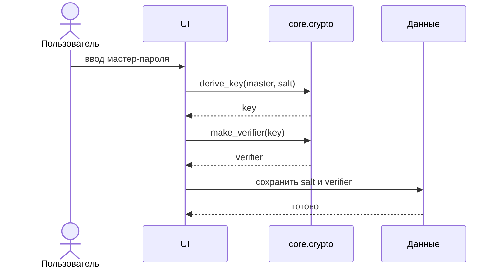
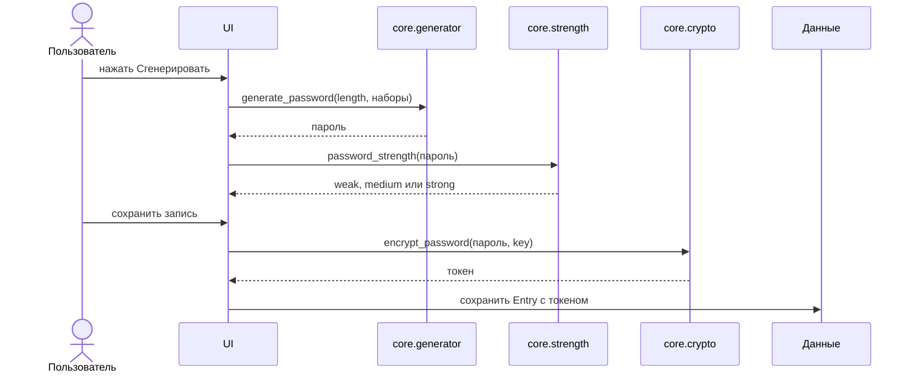
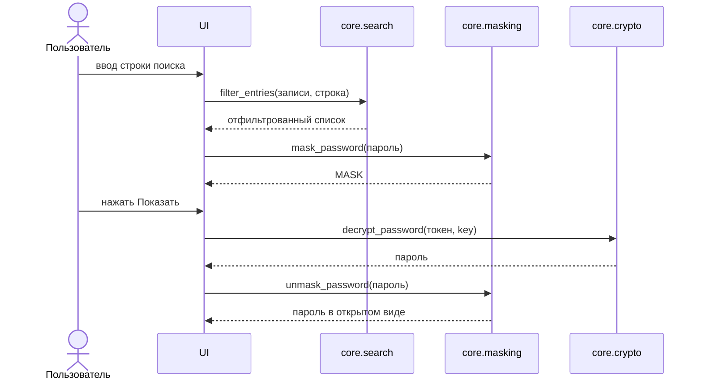

# Диаграммы последовательности (день 3)

## Сценарий 1. Первый запуск: создание мастер-пароля (US-1, M1)

## Сценарий 2. Добавление записи с генерацией пароля (US-2, US-5, M2)

## Сценарий 3. Поиск и показ пароля (US-6, US-7, M6, M7)

