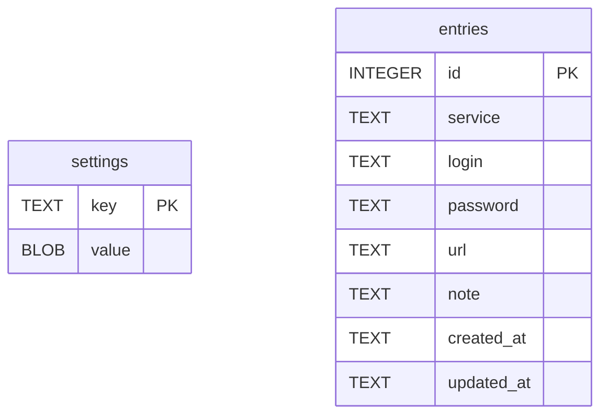
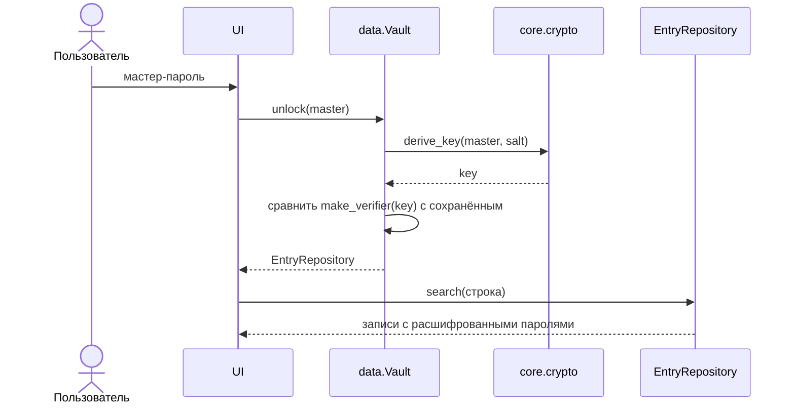

# Интеграция: слой данных и системные механизмы (день 4)

## Использованные механизмы
| Механизм | Где | Зачем |
|---|---|---|
| Локальная БД SQLite (модуль sqlite3) | src/data/db.py, repository.py, vault.py | хранение записей и настроек хранилища (M3) |
| Файловая система (pathlib) | src/data/db.py | файл БД лежит в домашней папке пользователя, недостающие папки создаются |
| Потоки (threading.Timer) | src/system/clipboard.py | очистка буфера обмена через 30 секунд (S1, US-8) |
| Журнал (logging) | все модули src/data и src/system | события и ошибки без паролей (NFR раздел 5) |

Сеть и внешние API не используются: приложение работает офлайн (ТЗ, раздел 4).

## Где лежит файл БД
`~/.password_manager/vault.db` (константа `DEFAULT_DB_PATH`). Файл вне репозитория, поэтому случайно попасть в Git он не может. В тестах путь передаётся явно.

## Схема БД

В settings лежат две строки: `salt` (16 случайных байт) и `verifier` (проверочное значение мастер-пароля). Мастер-пароль и ключ не хранятся. Поле entries.password содержит токен Fernet, а не пароль.

## Контракт слоя данных
| Модуль | Элемент | Поведение |
|---|---|---|
| db | `connect(path=DEFAULT_DB_PATH) -> sqlite3.Connection` | создаёт папки и таблицы, при ошибке StorageError |
| vault | `Vault(db_path)`; поддерживает `with` и `close()` | владеет соединением |
| vault | `is_initialized() -> bool` | есть ли соль в settings |
| vault | `create(master_password) -> EntryRepository` | пустой пароль ValidationError, повторное создание VaultAlreadyInitialized |
| vault | `unlock(master_password) -> EntryRepository` | VaultNotInitialized или WrongMasterPassword |
| repository | `add(entry) -> Entry` | возвращает запись с присвоенным id |
| repository | `get(id) -> Entry` | EntryNotFound |
| repository | `list_all() -> list[Entry]` | пароли расшифрованы |
| repository | `search(query) -> list[Entry]` | как core.filter_entries: сервис или логин, без учёта регистра |
| repository | `update(entry)` / `delete(id)` | EntryNotFound, update без id ValidationError |
| clipboard | `ClipboardGuard(set_text, clear, timeout=30.0, schedule=...)` | `copy(text)`, `clear_now()` |

Правила проверки записи: название сервиса и пароль обязательны, остальные поля могут быть пустыми.

## Связь с ядром
| Ядро (день 3) | Использование в слое данных |
|---|---|
| crypto.derive_key, make_verifier | создание и проверка хранилища в vault.py |
| crypto.encrypt_password, decrypt_password | шифрование при записи, расшифровка при чтении в repository.py |
| search.filter_entries | поиск в repository.search |
| models.Entry | единственный тип данных на границе слоя |

## Принятые решения
1. Поиск выполняется в Python через `filter_entries`, а не через SQL LIKE: LIKE в SQLite не различает регистр только для латиницы, кириллица («Почта» и «почта») не находилась бы.
2. Ключ выводится один раз при входе (PBKDF2 с 480 000 итераций), проверочное значение сравнивается через hmac.compare_digest.
3. Все запросы параметризованные, изменения идут в транзакциях (`with conn`).
4. ClipboardGuard не зависит от Tkinter: функции записи и очистки буфера и планировщик передаёт вызывающий код. UI на днях 5-6 подставит методы Tkinter.

## Сценарий: вход и показ записей

