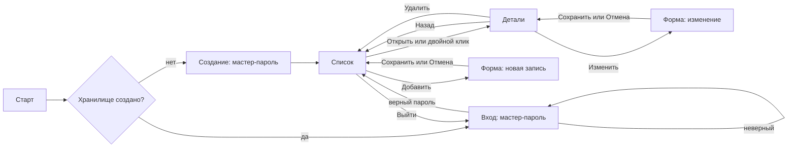

# Описание интерфейса (день 6)

Прототип сделан на Tkinter/ttk (desktop, по ТЗ). Запуск: `python -m src`.

## Экраны
| № | Экран | Файл макета | Файл скриншота | Код |
|---|---|---|---|---|
| 1 | Создание или вход по мастер-паролю | wireframes/01_login.png | screens/01_login_create.png | src/ui/login_view.py |
| 2 | Главный список с поиском | wireframes/02_list.png | screens/02_list_empty.png, screens/04_list.png | src/ui/list_view.py |
| 3 | Форма добавления и изменения | wireframes/03_form.png | screens/03_form_errors.png | src/ui/entry_form.py |
| 4 | Детали записи | wireframes/04_details.png | screens/05_details.png | src/ui/details_view.py |

Координатор экранов: src/ui/app.py (класс App). Он держит открытое хранилище, показывает нужный экран и очищает буфер обмена при выходе.

## Навигация

## Состояния экранов
| Состояние | Где | Что видит пользователь |
|---|---|---|
| Хранилище не создано | вход | заголовок «Создание хранилища», поле повтора пароля |
| Пустое хранилище | список | подсказка «Записей пока нет. Нажмите «Добавить», чтобы сохранить первый пароль.» |
| Поиск без результатов | список | «Ничего не найдено. Измените запрос поиска.» |
| Ошибки ввода | вход, форма | красный текст под полем |
| Ошибка слоя данных | любой | окно с текстом ошибки из DataError, без трассировки |
| Пароль скрыт | список, детали | «••••••••» |
| Пароль скопирован | список, детали | зелёный статус: очистка буфера через 30 секунд |

## Сообщения пользователю (русский язык)
| Ситуация | Текст |
|---|---|
| Пустой мастер-пароль | Введите мастер-пароль. |
| Пароли не совпадают | Пароли не совпадают. |
| Неверный мастер-пароль | Неверный мастер-пароль. |
| Пустое название сервиса | Укажите название сервиса. |
| Пустой пароль | Введите пароль. |
| Длина генератора вне 8-64 | Длина пароля от 8 до 64 символов. |
| Нет наборов символов | Выберите хотя бы один набор символов. |
| Удаление | Удалить запись «...»? Восстановить её будет нельзя. |

## Ограничения прототипа
- Мобильная версия не делается (ТЗ, раздел 3.4 «Won't»), поэтому вместо RecyclerView и Toast используются Treeview и messagebox.
- Экран смены мастер-пароля, экспорт и автоблокировка не входят в день.
- Буфер обмена очищается по таймеру (30 секунд) и при нажатии «Выйти» и закрытии окна.
